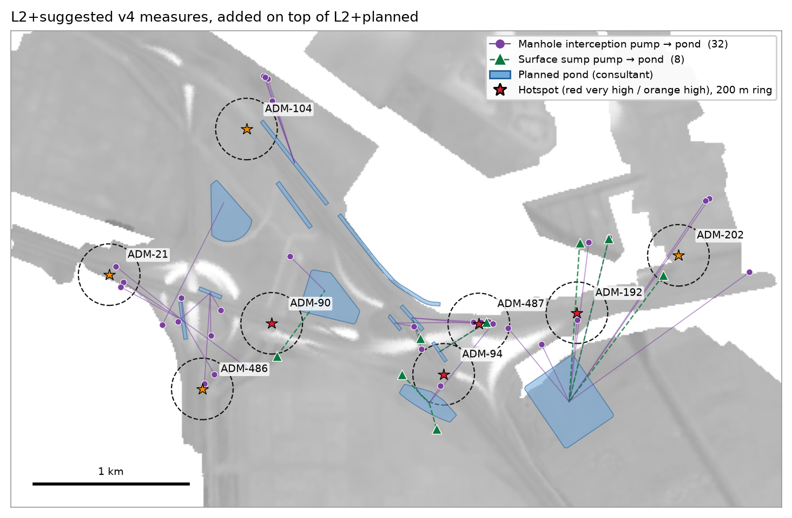
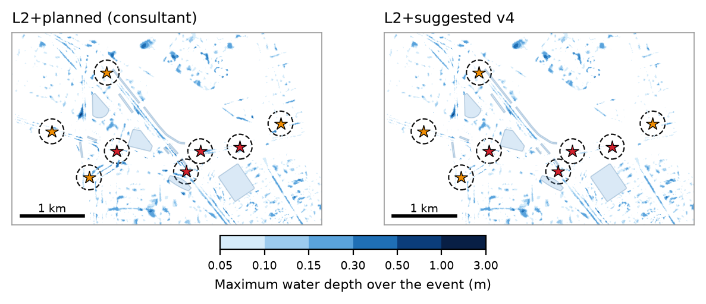
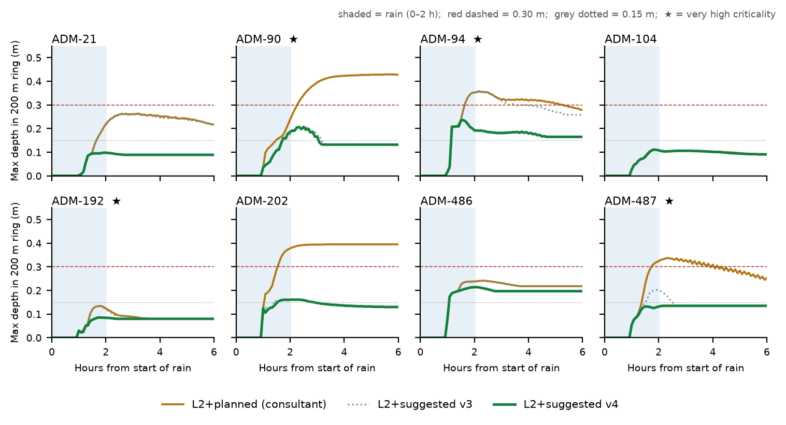
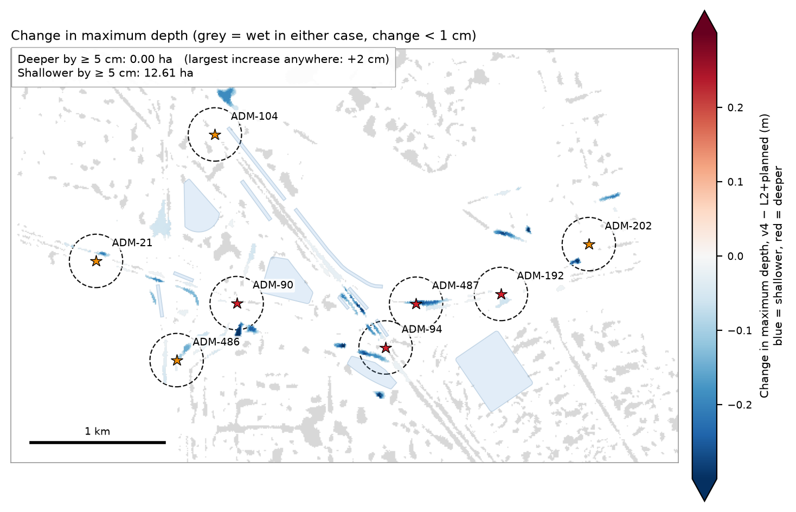
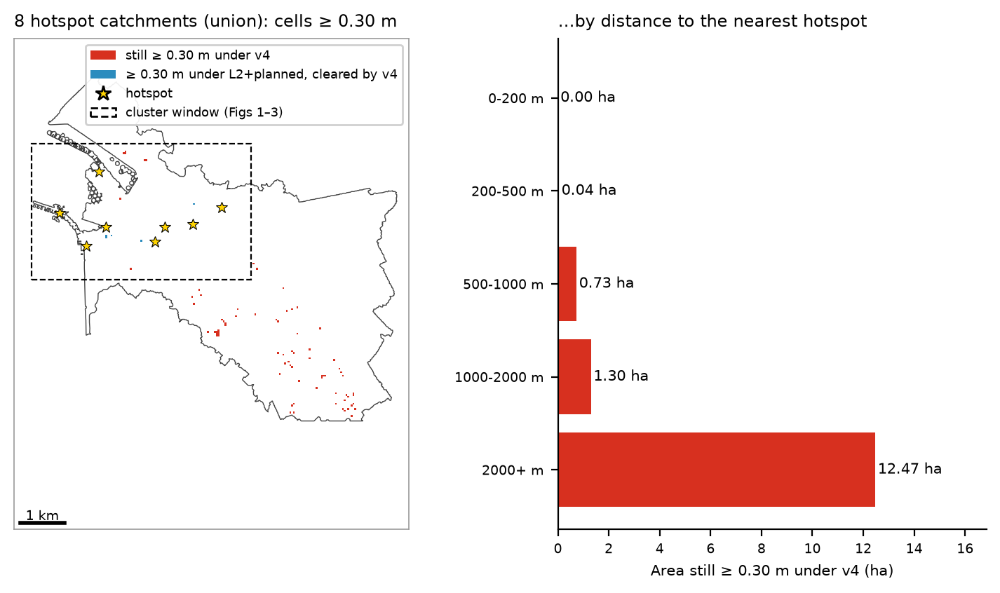

# Case 1 — Suggested Measures v4 vs Consultant's Planned Works

Abu Dhabi stormwater · C1 hotspot cluster · 2026-10-06

This note compares our suggested measures (L2+suggested v4) with the consultant's proposed works (L2+planned) at the eight C1 hotspots. Both are run on the same coupled 1D–2D hydrodynamic model (SWMM 5.2 + ANUGA) under the same 61 mm / 2 h design storm. v4 is added on top of L2+planned. Nothing in the consultant's works is removed or changed.

## Acceptance test

The test agreed for this round has two parts:

1. **At the hotspots**, flooded area and water depth must fall, and the water must clear sooner.
2. **Everywhere else**, nothing may get worse. Our test is strict: no model cell anywhere in the 38.1 km² domain may become 5 cm or more deeper than under L2+planned.

Hotspot results are measured inside a 200 m ring around each hotspot point.

## Headline results

| Measure (8 hotspots, 200 m rings) | L2+planned | L2+suggested v4 | Change |
|---|---|---|---|
| Area ever flooded ≥ 0.30 m | 0.270 ha | 0.000 ha | −100 % |
| Area × duration ≥ 0.30 m | 0.655 ha·h | 0.000 ha·h | −100 % |
| Area × duration ≥ 0.15 m | 7.50 ha·h | 0.58 ha·h | −92 % |
| Hotspots where peak depth drops by ≥ 5 cm | — | 5 of 8 | |
| **Area anywhere ≥ 5 cm deeper than L2+planned** | — | **0.00 ha** | largest increase in any cell: +2 cm |
| Area anywhere ≥ 5 cm shallower than L2+planned | — | 12.61 ha | |

In short: water 0.30 m deep or more no longer forms at any of the eight hotspots. Exposure to water 0.15 m deep or more falls by 92 %. No area becomes worse.

## 1. Why the planned works leave water standing

Four hours after the rain stops, L2+planned has removed only 16.7 % of the water on the ground: 642,833 m³ at 2 h, 535,351 m³ at 6 h. Once the pipes are full, water is pushed back up through the manholes: across the model, manholes overflow 1,841,015 m³ in total. Meanwhile the twelve planned ponds end the event between 3.7 % and 27.9 % full. They have room, but the water cannot get to them.

v4 therefore does two things, and both send water into ponds that still have capacity:

- **Intercept at the manhole.** A fixed pump is placed at the manholes that overflow most within 500 m of each hotspot. It moves the water to a planned pond before it reaches the street.
- **Clear the dips.** Where water still collects in low spots, a surface sump pump is sized to empty it within 1.5 h, also into a pond. It stops when the pond is full.

No terrain is changed, and nothing is pumped onto other land.

| v4 measures | Count | Capacity | Water moved into ponds |
|---|---|---|---|
| Manhole interception pumps (12-inch) | 32 | 11.52 m³/s | 26,946 m³ |
| Surface sump pumps (12-inch) | 8 | 2.88 m³/s | 6,895 m³ |
| **Total** | **40** | **14.40 m³/s** | **33,841 m³** |

The pump rating of 0.36 m³/s per 12-inch unit comes from the consultant's delivered model pump curve, which gives 361 L/s at 23 m head.

## 2. Results at each hotspot

| Hotspot | Criticality | Area ≥ 0.30 m (ha) planned → v4 | Peak depth (m) planned → v4 | Hours ≥ 0.15 m planned → v4 | Area × hours ≥ 0.15 m (ha·h) planned → v4 |
|---|---|---|---|---|---|
| ADM-21 | High | 0.000 → 0.000 | 0.26 → 0.10 | 4.4 → 0.0 | 0.29 → 0.00 |
| ADM-90 | Very high | 0.054 → 0.000 | 0.43 → 0.21 | 4.6 → 1.3 | 0.60 → 0.04 |
| ADM-94 | Very high | 0.060 → 0.000 | 0.36 → 0.24 | 4.9 → 4.9 | 2.79 → 0.26 |
| ADM-104 | High | 0.000 → 0.000 | 0.11 → 0.11 | 0.0 → 0.0 | 0.00 → 0.00 |
| ADM-192 | Very high | 0.000 → 0.000 | 0.13 → 0.09 | 0.0 → 0.0 | 0.00 → 0.00 |
| ADM-202 | High | 0.077 → 0.000 | 0.39 → 0.16 | 5.0 → 1.3 | 0.91 → 0.01 |
| ADM-486 | High | 0.000 → 0.000 | 0.24 → 0.21 | 5.0 → 5.0 | 0.85 → 0.27 |
| ADM-487 | Very high | 0.079 → 0.000 | 0.34 → 0.14 | 4.7 → 0.0 | 2.06 → 0.00 |

"Peak depth" and "hours ≥ 0.15 m" refer to the deepest point inside the 200 m ring. "Area × hours" sums every flooded cell in the ring over time. This is why ADM-94 can show the same 4.9 hours yet a 91 % smaller area × hours: one small low spot stays just above 0.15 m while the rest of the ring clears.

ADM-104 and ADM-192 were already shallow under L2+planned, below 0.15 m, so there was little to gain at either one. Under ADM-104 the v4 and planned lines lie on top of each other.

## 3. Nothing gets worse elsewhere

Figure 3 maps the change in maximum depth, v4 minus L2+planned, for every cell. Blue is shallower and red is deeper.

- **0.00 ha** anywhere in the domain is 5 cm or more deeper. The largest increase in any single cell is +2 cm (0.007 ha is 2 cm or more deeper).
- **12.61 ha** is 5 cm or more shallower.
- **No pond overflows.** Every pump stops when its pond reaches its limit. Ponds PND_C1_06, PND_C1_10 and PND_C1_11 finish 90–95 % full, so they cannot take more water in a future design.

## 4. The wider catchment figure

Earlier reports also quoted a second measure: area 0.30 m deep or more across the full catchments of the eight hotspots. These catchments cover 3,085 ha, much more than the hotspot sites themselves. On that measure, v4 reduces 15.34 ha (L2+planned) to 14.54 ha, which is −5 %.

The figure moves little because almost all of that water is far from the hotspots. Of the 14.54 ha that remains, 12.47 ha (86 %) lies more than 2 km from the nearest hotspot. Most of it lies in the south-east of the catchments (Figure 5), far from the hotspot sites, where the hotspot measures were never designed to act.

| Distance to nearest hotspot | Area still ≥ 0.30 m under v4 |
|---|---|
| 0–200 m | 0.00 ha |
| 200–500 m | 0.04 ha |
| 500–1,000 m | 0.73 ha |
| 1,000–2,000 m | 1.30 ha |
| more than 2,000 m | 12.47 ha |

We therefore recommend judging the hotspot works by the hotspot rings in Sections 2 and 3. If the inland water also needs treating, that is a separate catchment-scale task: intercepting runoff upstream and routing it to storage.

## 5. Limits and next steps

- **Shallow water is slow to clear.** At five hotspots (ADM-90 / 94 / 202 / 486 / 487), the deepest point still holds 0.13–0.20 m at the end of the 6 h run. v4 removes the deep water, but full drying is not yet achieved.
- **The layout is rule-based, not optimised.** Pumps were placed by fixed rules, and the 40 pumps are probably more than needed. One interception pump (C29) never switched on. Six more (C01, C05, C11, C16, C26, C32) ran less than 5 % of the time. One sump pump (S07) moved under 100 m³. These eight are candidates to remove. A proper optimisation would minimise pump count and cost subject to the same two tests, then confirm the result with the full model.
- **One storm only.** These results are for 61 mm / 2 h. The layout should also be checked under 96 mm / 2 h and under the consultant's 61.34 mm / 24 h design storm.
- **Site checks.** Pump locations, power supply and discharge pipe routes to the ponds have not been checked on the ground.
- **No cost estimate yet.**

## Run details

| Item | Value |
|---|---|
| Model | SWMM 5.2 (1D) + ANUGA (2D), two-way coupled at every manhole |
| Domain | 38.1 km², client models RB3 + Musaffah_RD09 + B_C |
| 2D mesh | 15 m (783,041 triangles) |
| Storm | 61 mm / 2 h design storm; 6 h simulated (2 h rain + 4 h recession), 5-minute frames |
| States compared | L2+planned (consultant) and L2+suggested v4 = L2+planned + 40 pumps |
| v4 run time | 1 h 40 min |
| Earlier version | L2+suggested v3 (reported previously): 0.039 ha ≥ 0.30 m and 3.48 ha·h ≥ 0.15 m in the rings; v4 brings these to 0.000 ha and 0.58 ha·h |

All figures and numbers in this note are produced by `tools/c1_v4_report.py` from the model output files. None are typed by hand.
