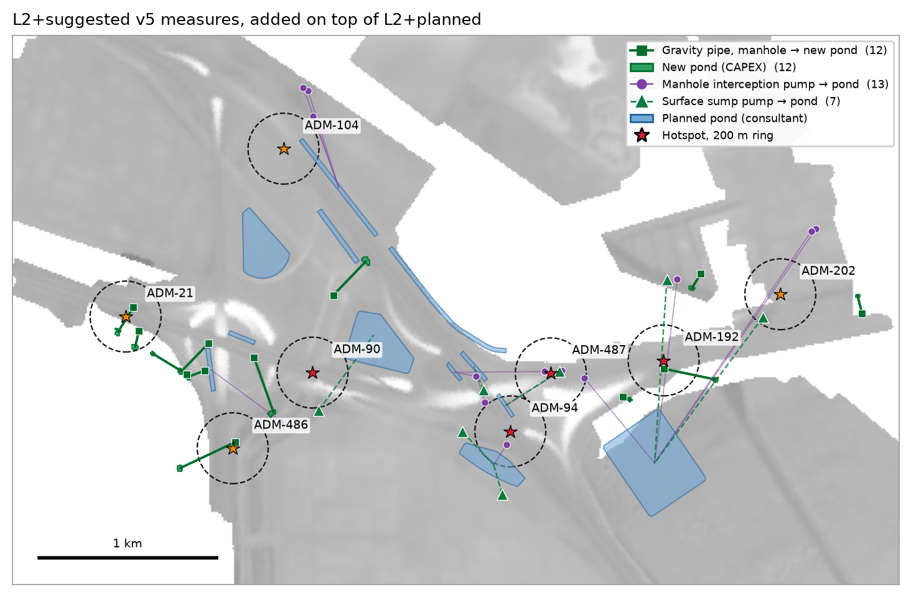
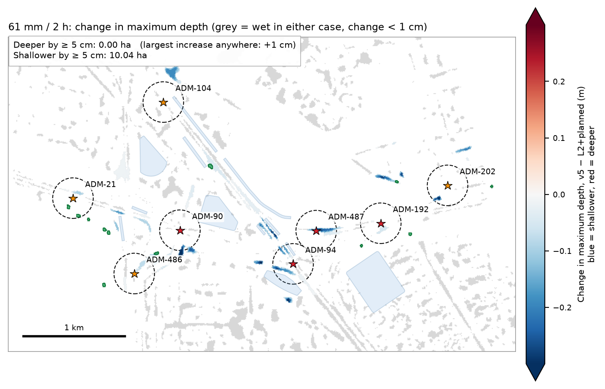
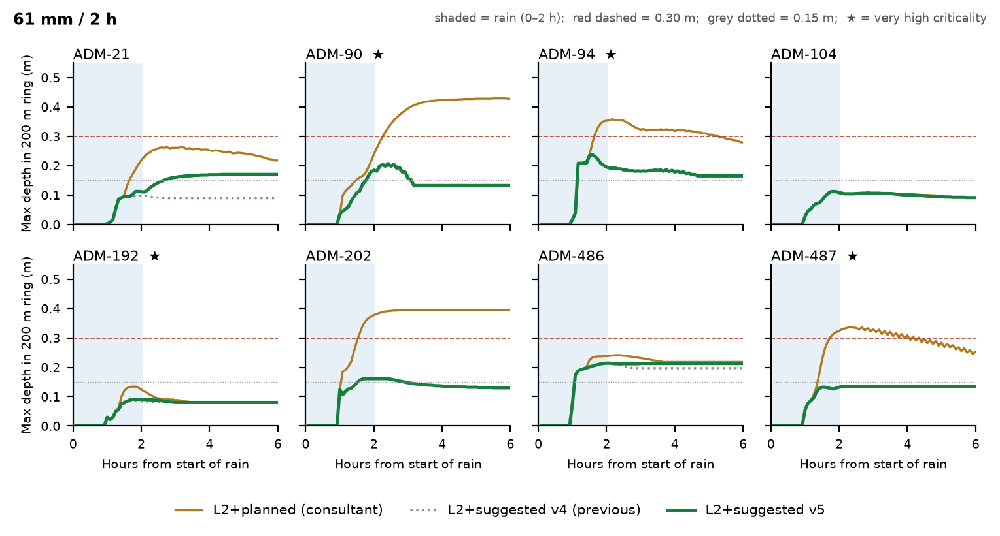
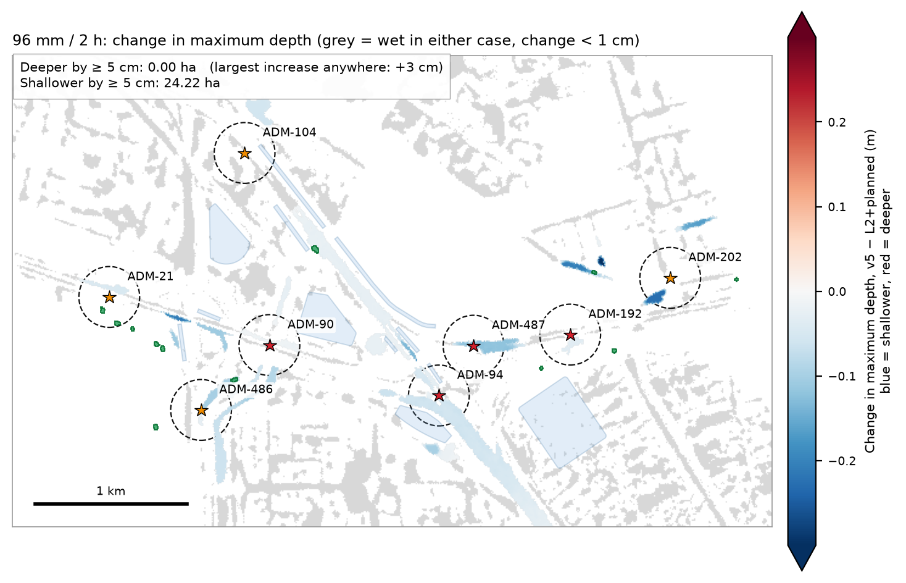
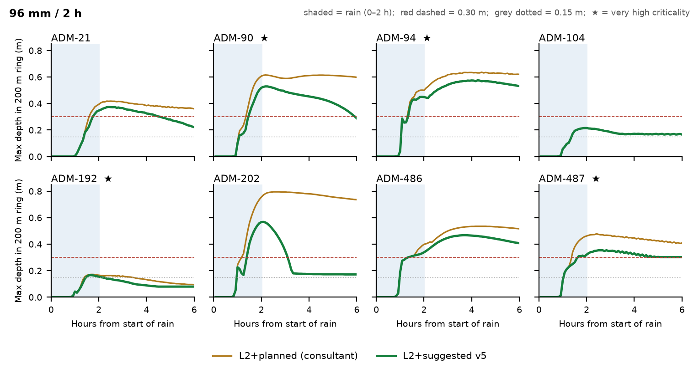

# Case 1 — Suggested Measures v5 vs Consultant's Planned Works

Abu Dhabi stormwater · C1 hotspot cluster · 2026-10-07

This note compares our suggested measures (L2+suggested v5) with the consultant's proposed works (L2+planned) at the eight C1 hotspots. Both are run on the same coupled 1D–2D hydrodynamic model (SWMM 5.2 + ANUGA). v5 is added on top of L2+planned. Nothing in the consultant's works is removed or changed.

v5 is designed for the 61 mm / 2 h design storm. The same layout is then tested, unchanged, under a 96 mm / 2 h storm.

## Acceptance test

1. **At the hotspots**, flooded area and water depth must fall, and the water must clear sooner.
2. **Everywhere else**, nothing may get worse: no model cell anywhere in the 38.1 km² domain may become 5 cm or more deeper than under L2+planned in the same storm.

Hotspot results are measured inside a 200 m ring around each hotspot point.

## Headline results

| Measure (8 hotspots, 200 m rings) | 61 mm: L2+planned → v5 | 96 mm: L2+planned → v5 |
|---|---|---|
| Area ever flooded ≥ 0.30 m | 0.270 → **0.000 ha** (−100 %) | 4.01 → **2.28 ha** (−43 %) |
| Area × duration ≥ 0.15 m | 7.50 → **0.69 ha·h** (−91 %) | 33.9 → **21.8 ha·h** (−36 %) |
| **Area anywhere ≥ 5 cm deeper than L2+planned** | **0.00 ha** (largest increase: +1 cm) | **0.00 ha** (largest increase: +3 cm) |
| Area anywhere ≥ 5 cm shallower | 10.04 ha | 24.22 ha |

| Measures | v5 |
|---|---|
| Pumps (12-inch, 0.36 m³/s each) | **20**, 7.2 m³/s |
| New ponds (CAPEX) | 12, 13,574 m³ in total |
| Gravity pipes, manhole → new pond | 12 |

In the design storm, water 0.30 m deep or more no longer forms at any of the eight hotspots, and exposure to water 0.15 m deep or more falls by 91 %. In the heavier 96 mm storm the same layout still improves seven of the eight hotspots, but does not clear them. In neither storm does any area become worse.

## 1. What v5 adds

Under L2+planned, most of the water near the hotspots is pushed up out of manholes once the pipes are full. v5 takes that water away before it reaches the street, in two ways:

- **Gravity relief to a new pond (12 manholes).** Where open, lower-lying land exists within 500 m, a small pond is excavated and connected to the manhole by a pipe. When the water in the manhole rises to 0.5 m below the cover, it flows to the pond by gravity. A flap gate stops it flowing back. No power is needed.
- **Pumps (20).** Where no suitable pond site exists, the manhole keeps a 12-inch pump to a planned pond (13 manholes). Seven surface sump pumps clear low spots into planned ponds.

The consultant's planned ponds sit higher than almost all of the overflowing manholes, so water cannot reach them by gravity. That is why the new ponds are needed.

| New ponds and pipes | Value |
|---|---|
| Ponds | 12; 375–1,400 m² each; 562–2,100 m³ each; 13,574 m³ in total |
| Depth / excavation | 1.5 m, vertical sides; floor level 0.07–1.66 m; about 12,000 m³ of excavation |
| Siting rule | Pond rim at least 0.5 m below the manhole cover; site at least 20 m wide; clear of buildings, roads and planned ponds |
| Gravity pipes | 12; Ø 0.60–0.90 m; 54–410 m long; flap gate at the outlet |

## 2. Results in the 61 mm / 2 h design storm

| Hotspot | Criticality | Area ≥ 0.30 m (ha) planned → v5 | Peak depth (m) planned → v5 | Hours ≥ 0.15 m planned → v5 | Area × hours ≥ 0.15 m (ha·h) planned → v5 |
|---|---|---|---|---|---|
| ADM-21 | High | 0.000 → 0.000 | 0.26 → 0.17 | 4.4 → 3.4 | 0.29 → 0.03 |
| ADM-90 | Very high | 0.054 → 0.000 | 0.43 → 0.21 | 4.6 → 1.3 | 0.60 → 0.04 |
| ADM-94 | Very high | 0.060 → 0.000 | 0.36 → 0.24 | 4.9 → 4.9 | 2.79 → 0.26 |
| ADM-104 | High | 0.000 → 0.000 | 0.11 → 0.11 | 0.0 → 0.0 | 0.00 → 0.00 |
| ADM-192 | Very high | 0.000 → 0.000 | 0.13 → 0.09 | 0.0 → 0.0 | 0.00 → 0.00 |
| ADM-202 | High | 0.077 → 0.000 | 0.39 → 0.16 | 5.0 → 1.3 | 0.91 → 0.01 |
| ADM-486 | High | 0.000 → 0.000 | 0.24 → 0.21 | 5.0 → 5.0 | 0.85 → 0.35 |
| ADM-487 | Very high | 0.079 → 0.000 | 0.34 → 0.14 | 4.7 → 0.0 | 2.06 → 0.00 |

"Peak depth" and "hours ≥ 0.15 m" refer to the deepest point inside the ring. "Area × hours" sums every flooded cell in the ring over time. At ADM-94 and ADM-486 one small low spot stays just above 0.15 m while the rest of the ring clears.

The new ponds took 8,870 m³ in this storm, including 2,415 m³ of surface water landing directly on them. Two ponds filled; one (next to ADM-21) overflowed 492 m³ onto its own site.

## 3. The heavier 96 mm / 2 h storm

The v5 layout was not resized for this storm. The run shows how far the 61 mm design carries.

| Hotspot | Area ≥ 0.30 m (ha) planned → v5 | Peak depth (m) planned → v5 | Area × hours ≥ 0.15 m (ha·h) planned → v5 |
|---|---|---|---|
| ADM-21 | 0.084 → 0.060 | 0.42 → 0.37 | 1.89 → 0.84 |
| ADM-90 | 0.383 → 0.327 | 0.61 → 0.53 | 4.05 → 3.26 |
| ADM-94 | 1.842 → 1.289 | 0.64 → 0.57 | 12.75 → 9.67 |
| ADM-104 | 0.000 → 0.000 | 0.21 → 0.22 | 0.19 → 0.19 |
| ADM-192 | 0.000 → 0.000 | 0.17 → 0.17 | 0.06 → 0.00 |
| ADM-202 | 0.421 → 0.207 | 0.80 → 0.57 | 2.80 → 0.68 |
| ADM-486 | 0.692 → 0.272 | 0.54 → 0.47 | 6.34 → 4.63 |
| ADM-487 | 0.589 → 0.129 | 0.48 → 0.35 | 5.78 → 2.56 |

In this storm the measures run out of room. Eight of the twelve new ponds filled and overflowed 4,136 m³ in total onto their own sites. Planned ponds PND_C1_06 and PND_C1_07 also overflowed (93 and 287 m³). Water deeper than 0.30 m remains at ADM-94, ADM-90, ADM-486, ADM-202, ADM-487 and ADM-21. Meeting the hotspot target in a 96 mm storm would need larger ponds and more relief capacity.

## 4. The wider catchment figure

Across the full catchments of the eight hotspots (3,085 ha), the area 0.30 m deep or more changes from 15.34 to 14.47 ha in the 61 mm storm and from 70.25 to 64.73 ha in the 96 mm storm. Most of this water lies far from the hotspots, where the hotspot measures were never designed to act. We therefore recommend judging the hotspot works by the hotspot rings in Sections 2 and 3.

## 5. Limits and next steps

- **Land.** The municipal land database was not available. Pond sites were screened with OpenStreetMap: they avoid mapped buildings, roads, parking, schools, mosques, sports grounds and similar uses. All twelve sites fall on land with no mapped use in OpenStreetMap. Each site must be confirmed against the official land records before it is taken further.
- **Groundwater and ground conditions.** Pond floors are 0.07–1.66 m above datum. In coastal Abu Dhabi the water table may be close to this. Ground investigation is needed before excavation depth is fixed.
- **Sizing.** Ponds were sized at twice each manhole's overflow volume in the planned case, for the 61 mm storm. The 96 mm run shows this is too small for heavier events.
- **Rule-based layout.** Measures were placed by fixed rules, not optimised. A proper optimisation would minimise cost subject to the same two tests, over more than one storm.
- **Site checks.** Pipe routes, pump locations and power supply have not been checked on the ground.
- **No cost estimate yet.**

## Run details

| Item | Value |
|---|---|
| Model | SWMM 5.2 (1D) + ANUGA (2D), two-way coupled at every manhole |
| Domain | 38.1 km², client models RB3 + Musaffah_RD09 + B_C |
| 2D mesh | 15 m (783,041 triangles) |
| Storms | 61 mm / 2 h design storm; 96 mm / 2 h (same profile, scaled); 6 h simulated, 5-minute frames |
| States compared | L2+planned (consultant) and L2+suggested v5 = L2+planned + 12 new ponds + 12 gravity pipes + 20 pumps |
| Terrain | Client 5 m DTM; land use OpenStreetMap, 2026-10-07 |
| Earlier version | v4 (40 pumps, 14.4 m³/s) cleared the 61 mm rings to the same 0.000 ha with 0.58 ha·h ≥ 0.15 m. v5 uses half the pumps for 0.69 ha·h. It is slightly less effective than v4 at ADM-21 and ADM-486, where the gravity pipe starts later than a pump would. |

All figures and numbers in this note are produced by `tools/c1_v5_report.py` from the model output files. None are typed by hand.
