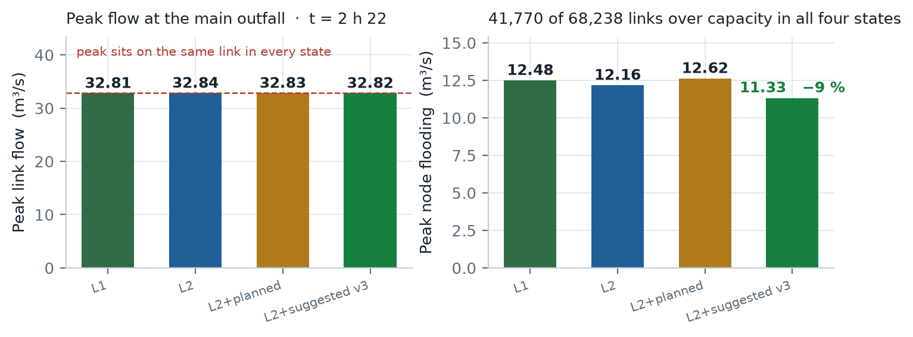
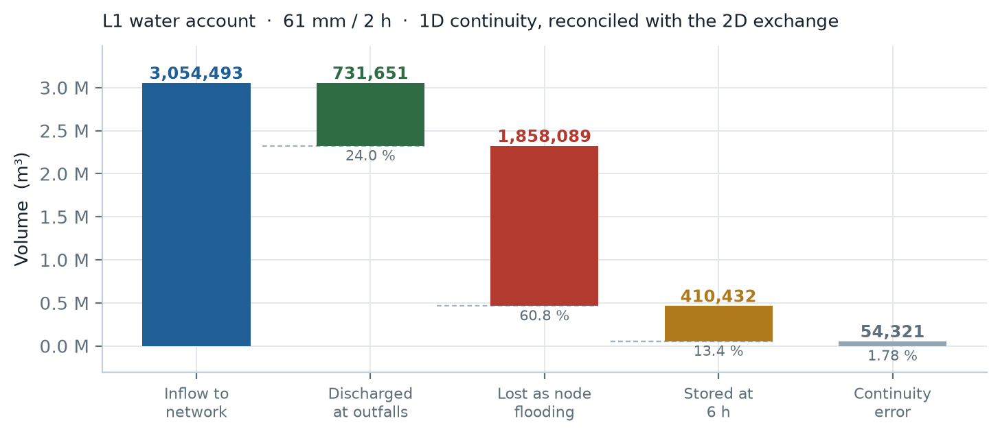
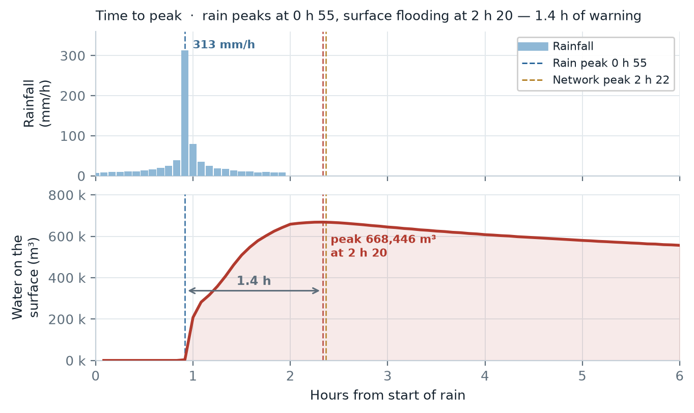
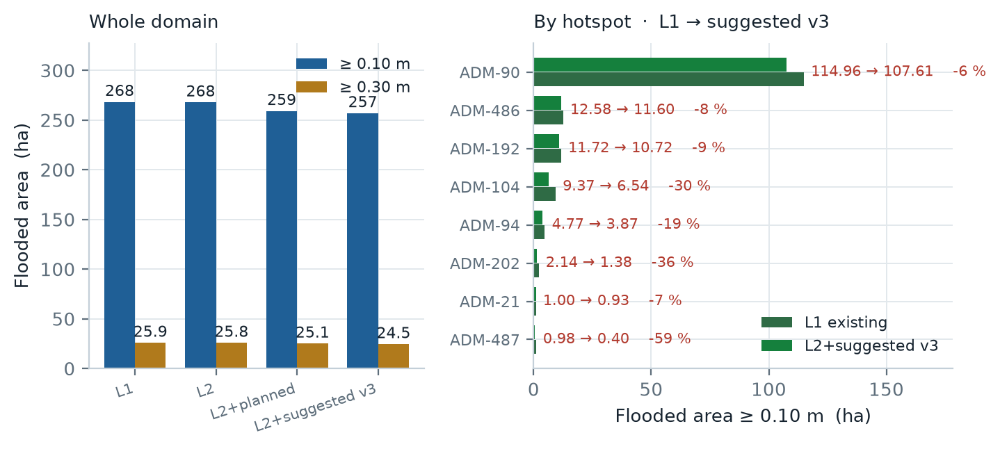

# Case 1 Baseline Assessment — C1 Hotspot Cluster

Abu Dhabi stormwater · scenario testing · 2026-10-03

Capacity assessment of the C1 hotspot cluster under a 61 mm / 2 h design storm, computed with a coupled 1D–2D hydrodynamic model (SWMM 5.2 + ANUGA) on the authoritative model-version domain. Four asset states are compared: existing network (L1), plus temporary measures (L2), plus the consultant's proposed works (L2+planned), plus our suggested measures (L2+suggested v3).

## Run summary

| Item | Value |
|---|---|
| Scheme | C1 · 8 hotspots (ADM-21 / 90 / 94 / 104 / 192 / 202 / 486 / 487) |
| Rainfall case | 61 mm / 2 h design storm |
| Net rain | 23.5 mm · CN 82 · Tc 30 min |
| Peak intensity | 313 mm/h at 0 h 55 |
| Domain | 38.1 km² · model version (client models RB3 + Musaffah_RD09 + B_C) |
| 1D / 2D | SWMM 5.2 · ANUGA, coupled two-way, 15 m grid |
| Simulated | 6 h (2 h rain + 4 h recession), 72 frames at 5-minute steps |
| States | L1 · L2 · L2+planned · L2+suggested v3 |

## 1. Peak flow and network capacity

The model reports peak flow for every link and every node. 68,238 links carry flow.

| State | Peak link flow (m³/s) | Time of peak | Links over capacity | Share over capacity | Peak node flooding (m³/s) |
|---|---|---|---|---|---|
| L1 existing network | 32.81 | 2 h 22 | 41,770 | 61.2 % | 12.48 |
| L2 + temporary measures | 32.84 | 2 h 22 | 41,777 | 61.2 % | 12.16 |
| L2+planned (consultant) | 32.83 | 2 h 22 | 41,751 | 61.2 % | 12.62 |
| L2+suggested v3 | 32.82 | 2 h 22 | 41,788 | 61.2 % | 11.33 |

- The three highest flows sit on the same links in every state (peak 32.81 m³/s at the main outfall), so the capacity shortfall is structural, not caused by any one measure.
- 55,881 nodes flood at some point during the storm; 11,521 of them stay flooded for 30 minutes or more.
- Adding measures rearranges flow at the margin — peak node flooding falls 9 % under L2+suggested v3 — but does not lift the network above capacity.

## 2. Runoff volume

Volumes come from the 1D flow-routing continuity table and from the 1D–2D exchange account, so the two sides reconcile against each other.

### Water account for the 61 mm / 2 h event — L1 existing network

| Component | Volume | Share of inflow |
|---|---|---|
| Inflow to the network | 3,054,493 m³ | 100 % |
| Discharged at outfalls | 731,651 m³ | 24.0 % |
| Lost as node flooding (surplus) | 1,858,089 m³ | 60.8 % |
| Still stored at end of simulation | 410,432 m³ | 13.4 % |
| Continuity error | 1.78 % | — |

### 1D–2D exchange — the surplus on the surface, by state (m³)

| Component | L1 | L2 | L2+planned | L2+suggested v3 |
|---|---|---|---|---|
| Network spill to surface | 732,413 | 729,200 | 717,765 | 710,914 |
| Surface return to network | 569,293 | 566,986 | 559,883 | 555,059 |
| Rain falling directly on the 2D grid | 492,717 | 492,717 | 492,717 | 492,717 |
| Captured into ponds | 0 | 0 | 17,287 | 17,278 |
| Water still on the surface at 6 h | 556,293 | 556,124 | 535,351 | 529,700 |

The measured spill — a node-by-node sum of 1,855,691 m³ — matches the continuity loss above to within 0.13 %. That reconciliation is the check applied to every run.

## 3. Time to peak

Each stage of the event peaks at a different hour. The lag between the rainfall peak and the flood peak sets the mobilisation window.

| Stage | Peak at | What peaks |
|---|---|---|
| Rainfall | 0 h 55 | 313 mm/h |
| Network flow | 2 h 22 | 32.81 m³/s at the main outfall |
| Surface flooding | 2 h 20 | 668,446 m³ ponded (L1) |
| Wet surface area | 2 h 00 | 679.9 ha with water on it (L1) |

- Rainfall peaks at 0 h 55; flooding peaks about 1.4 h later. That lag is the response time of the cluster and bounds how late a measure can be deployed and still act on the peak.
- Individual hotspot catchments peak between 2 h 05 and 2 h 35 — a spread of about 30 minutes.

## 4. Expected flood extent

The 2D model gives flooded area, depth and volume at 5-minute resolution, which is the part a 1D model alone cannot produce. Volumes below are the peak ponded volume; areas use the maximum depth reached during the event.

### Flood extent and volume by state — whole domain

| State | Area ≥ 0.10 m (ha) | Area ≥ 0.30 m (ha) | Peak volume (m³) | Wet area at peak (ha) | Max depth (m) |
|---|---|---|---|---|---|
| L1 existing network | 268.3 | 25.86 | 668,446 | 679.9 | 1.94 |
| L2 + temporary measures | 267.8 | 25.82 | 667,146 | 679.0 | 1.94 |
| L2+planned (consultant) | 259.1 | 25.07 | 650,713 | 665.0 | 1.94 |
| L2+suggested v3 | 256.9 | 24.50 | 645,754 | 662.8 | 1.94 |

### The eight hotspots

Flooded area and volume inside each hotspot catchment, existing network versus suggested measures.

| Hotspot | L1 ≥ 0.10 m (ha) | L1 ≥ 0.30 m (ha) | L1 peak vol (m³) | v3 ≥ 0.10 m (ha) | v3 ≥ 0.30 m (ha) | v3 peak vol (m³) | Area change |
|---|---|---|---|---|---|---|---|
| ADM-21 | 1.00 | 0.00 | 2,538 | 0.93 | 0.00 | 2,392 | −7 % |
| ADM-90 | 114.96 | 14.43 | 276,829 | 107.61 | 13.71 | 262,245 | −6 % |
| ADM-94 | 4.77 | 0.30 | 10,275 | 3.87 | 0.10 | 8,545 | −19 % |
| ADM-104 | 9.37 | 0.32 | 21,503 | 6.54 | 0.06 | 15,772 | −30 % |
| ADM-192 | 11.72 | 1.06 | 28,753 | 10.72 | 0.86 | 26,061 | −9 % |
| ADM-202 | 2.14 | 0.09 | 6,765 | 1.38 | 0.00 | 4,986 | −36 % |
| ADM-486 | 12.58 | 0.46 | 30,074 | 11.60 | 0.15 | 28,334 | −8 % |
| ADM-487 | 0.98 | 0.09 | 2,257 | 0.40 | 0.00 | 965 | −59 % |
| **Eight hotspots, combined** | **143.46** | **15.99** | **346,024** | **133.25** | **14.73** | **325,168** | **−7 %** |

- The deepest water — 1.94 m — sits inside the ADM-90 catchment in every state. No measure in any scenario changes it, which points to a capacity problem upstream of the hotspot rather than a local one.
- Measures help most at the hotspots with shallow, localised ponding: ADM-202 loses 36 % of its flooded area, ADM-487 loses 59 %. The two large catchments, ADM-90 and ADM-192, barely move at 6 % and 9 %.
- Within 200 m of the hotspots, the ≥ 0.30 m area falls from 0.40 ha to 0.04 ha — a 90 % reduction. Extents, depths and velocities are also delivered as GeoTIFF and as an ANUGA .sww file for GIS use.

## Still open

**Network resilience (24 h).** The current runs simulate 6 hours (2 h of rain plus 4 h of recession). At the 6-hour mark the surface still holds 490–510 ha of water, so the event is not over. A 24-hour resilience figure needs two steps not yet taken: agreed metrics (time to drain, duration above capacity, recovery time), and runs extended to 24 hours.

**ERP resources required.** The model reports what each facility actually does during the storm, not what would be needed to clear the water. Turning it into "pumps, tankers and manpower required" is a conversion layer on top of the model: peak volume against a target drain-down time, unit pump and tanker capacities, crew per unit, and access. The inputs are all in hand — peak ponded volume 668,446 m³, pump capacities, recession curves — so this is rule work, not new simulation.

**Rainfall cases from the brief.** The 1-in-10-year +20 % case (61.34 mm / 24 h) was run earlier on the older domain and has been withdrawn, because that domain is not the authoritative one; the 2024 event has not been run for this cluster. Both are straightforward to add on the model-version domain, at roughly 21 simulated hours per state for a 24-hour storm.

## How to read these numbers

Rainfall is the client's own 2-hour design hyetograph (Mussafah model), scaled to 61 mm. 1D is SWMM 5.2 and 2D is ANUGA at 15 m, coupled two-way at every step. Flood depth is triangle-centroid depth; ground below 0.02 m counts as dry. Flooded area counts triangles whose maximum depth reaches the threshold. Every state was built and run with the same model, so the four columns are directly comparable.

**Checks on this run.** 1D continuity error 1.7–1.8 %; the node-summed spill reconciles with the continuity loss to 0.13 %; the 1D↔2D exchange is accounted in both directions; 72 frames render with no NaN. Results are reconciled against the consultant's own model for the same area as a cross-check.

**Known limits.** One catchment (ADM-90) extends past the analysis window, so inflow from outside it is not counted, which understates that area. Runoff uses a uniform CN of 82. Ground elevation comes from the 5 m DTM. Two existing pump stations have no operating data and were not modelled, and the location of two others is inferred.
