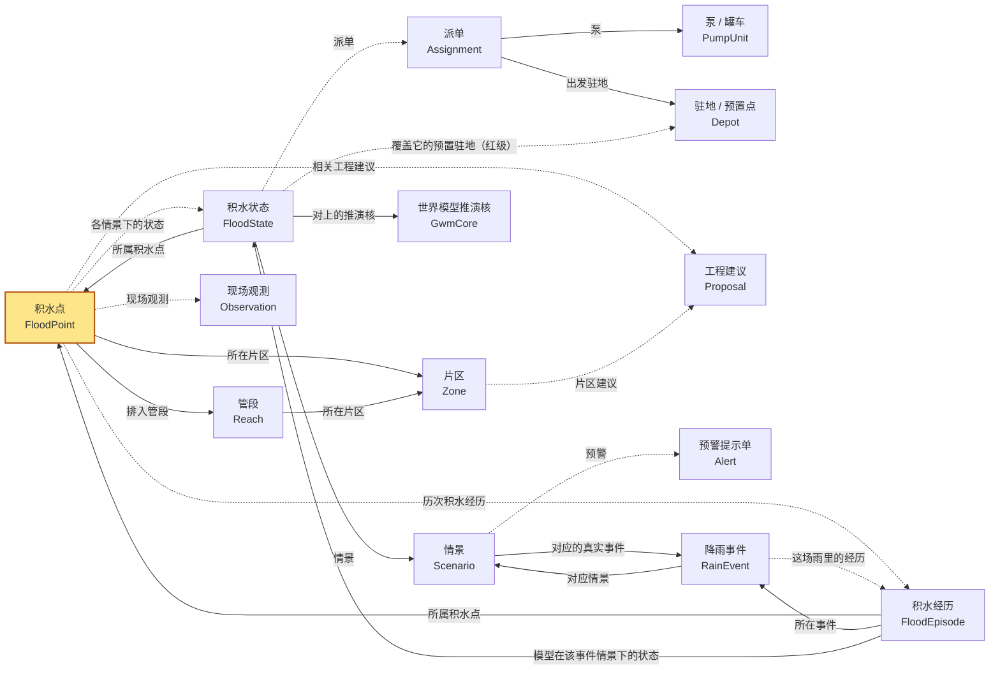

# 本体模型：以「积水点」为核心（2026-09-21）

> 借 Palantir Foundry Ontology 的骨架——**对象类型（Object Type）／关系（Link Type）／规则（Rule，对应 Foundry 的 Function）／动作（Action Type）**——把排水智能体已有的计算结果组织成一层语义模型，再让智能体只通过这层模型看世界、做事。声明在 `swbrain/ontology/schema.py`，物化与执行在 `runtime.py`，交互入口在 `agent.py`。本文的表由声明生成，动作 / 规则改了跑 `python -m swbrain.ontology --doc` 重出。

## 1. 为什么是本体，为什么核心是积水点

系统里原来有十几个算法模块（管网承载筛查、全网溢流路由、积水水量平衡、调度求解、重演、预置价值、预警规则、热点详情、世界模型对照、报告……），每个都有自己的输入输出字典。给客户讲、给智能体用，都需要一个稳定的名词体系：**这个地点是谁、它在这场雨下怎样、谁去处置、处置得怎样、和客户登记 / 顾问模型 / 世界模型是否对得上**。这些问题都绕着一个东西转——**积水点**。所以：

- `FloodPoint`（积水点）是核心对象，主键沿用客户编号（ADM-62；Parsons 的 HS-62 等于 ADM-62），静态属性来自客户清单 + 5 m DTM + 管段匹配 + 全网路由；
- 随雨变的东西拆到 `FloodState`（积水状态，主键 `fp_id@情景`），一个积水点在 8 个情景下有 8 个状态；
- 其余对象（情景、管段、片区、泵、驻地、派单、工程建议、世界模型推演核、预警单、现场观测）都通过关系挂到积水点或它的状态上。

Palantir 的四个概念在这里分别是：

| Foundry | 这里 | 说明 |
|---|---|---|
| Object Type + Properties | `ObjectType` / `Property` | 带主键、标题属性、类型、来源、由哪条规则派生 |
| Link Type | `LinkType` | 有方向有基数，靠属性值对齐（外键），运行时按需物化 |
| Function（派生 / 校验） | `Rule`（derive / validate / trigger） | 对象字典上的纯函数，能单独解释、单独测试；derive 的结果会和存量值比对一致性 |
| Action Type | `ActionType` + `Parameter` | 带类型与范围校验、前置条件、副作用声明（只读 / 写 out/…，永不写源库），执行记进 `out/ontology_actions.jsonl` |

## 2. 对象类型（14 个）

<!-- gen:objects -->
| api | 名称 | 主键 | 属性数 | 作用域 | 说明 |
|---|---|---|---|---|---|
| `FloodPoint` | 积水点 / Flood point | `fp_id` | 38 | 静态 | 核心对象：一个会积水的地点。来自客户 845 个热点（ADM/AAM/DRM）并被本系统补齐地形、匹配管段与全网溢流；主键沿用客户编号（ADM-62）。与情景无关的静态属性放这里，随雨变的放 FloodState。 |
| `FloodState` | 积水状态 / Flood state | `state_id` | 32 | 随情景 | 积水点在某个情景（重现期 / 实测事件）下的状态：体积、水深、等级、可派性、派单与结果。主键 fp_id@情景。 |
| `Scenario` | 情景 / Scenario | `key` | 19 | 静态 | 一场雨：重现期（5/10/25/50/100 年）、重现期 + 气候变化、或实测事件（2024-04、2026-03）。带该情景下全网与调度的汇总。 |
| `Reach` | 管段 / Reach | `gid` | 17 | 静态 | 雨水管网的一段（源库 sw_edge），带设计校核与 10 年全网路由结果。 |
| `Zone` | 片区 / Zone | `zone_name` | 12 | 静态 | 管网片区（sw_edge.zone_name），带风险分、超载份额、蓄渗缺口、堵塞率。 |
| `PumpUnit` | 泵 / 罐车 / Pump unit | `unit_id` | 7 | 静态 | 一台可派的移动泵或罐车（客户预案 A 的泵队按驻地展开）。 |
| `Depot` | 驻地 / 预置点 / Depot | `depot_id` | 8 | 静态 | 泵队驻地（民防中心等）与预置候选驻地。 |
| `Assignment` | 派单 / Assignment | `assignment_id` | 14 | 随情景 | 某情景、某决策时刻下，一台泵到一个积水点的派遣（波次、行程、到位、排干、达标）。 |
| `Proposal` | 工程建议 / Proposal | `pid` | 15 | 静态 | 第一道防线的基础设施建议（扩管 / 调蓄 / 核实终点 / 维护 …），带优先级、置信度、法定依据与对应客户热点。 |
| `GwmCore` | 世界模型推演核 / World-model core | `core_id` | 13 | 随情景 | 世界模型（GWM）250 m 格网推演聚成的积水核，带与客户热点 / 本系统的对照标签。主键 run_id:fp_id。 |
| `Alert` | 预警提示单 / Alert advisory | `alert_id` | 8 | 静态 | 按预报雨量代入规则层得到的等级与分角色提示（issue_alert 动作的产物，落 out/alerts/）。 |
| `Observation` | 现场观测 / Field observation | `obs_id` | 7 | 静态 | 现场对某积水点的一次观测（record_observation 动作写入 out/observations.jsonl），是校核推演的地面真值。 |
| `RainEvent` | 降雨事件 / Rain event | `event_id` | 23 | 静态 | 一场真实（或预报中 / 进行中）的雨：历史事件 2024-04、2026-03 来自 [scenarios.events]，客户补的历史事件来自 exchange/events.json，值班开的预报 / 进行中事件来自 open_event 动作（out/events.jsonl）。每个事件对上一个情景做模型这一侧；一场雨过后按它的积水经历与推演对账。 |
| `FloodEpisode` | 积水经历 / Flood episode | `episode_id` | 22 | 静态 | 一个积水点在一场雨里的一次经历：预警待命 → 已预置 → 已上报 → 已核实 → 已派单 → 到位 → 抽排 → 退干 → 关闭 → 复盘 的时间戳，现场观测到的水深 / 时长、实际派泵与退干，来源（客户记录 / 现场观测 / 993 / 本系统日志 / 推演估计），以及模型在该事件情景下的推演与二者的对账。主键 fp_id@event_id。 |
<!-- /gen -->

### 2.1 积水点 `FloodPoint` 的属性

<!-- gen:fp_props -->
| 属性 | 类型 | 名称 | 说明 | 来源 / 派生 |
|---|---|---|---|---|
| `fp_id` | str | 编号 |  | 客户热点清单 v4.4 |
| `region` | enum | 所属市政 | ADM / AAM / DRM |  |
| `area` | str | 片区（客户） |  |  |
| `location` | str | 位置描述 |  |  |
| `lon` | float | 经度 | KMZ 修正后的坐标 | 506 Hot Spots AUH.kmz |
| `lat` | float | 纬度 |  |  |
| `coord_source` | enum | 坐标来源 | kmz = 已用 KMZ 修正；xlsx = 只有表格坐标 |  |
| `criticality` | enum | 客户重要度 | Very High / High / Medium / Low |  |
| `root_cause` | str | 根因（归类） |  |  |
| `network_available` | bool | 客户标注有无管网 |  |  |
| `planA_pumps` | int | 预案 A 泵数 |  |  |
| `planA_pump12` | int | 预案 A 12 寸泵 |  |  |
| `planA_pump8` | int | 预案 A 8 寸泵 |  |  |
| `planA_pump6` | int | 预案 A 6 寸泵 |  |  |
| `planA_tankers` | int | 预案 A 罐车 |  |  |
| `planA_manpower` | int | 预案 A 人力 |  |  |
| `idd_planned_flag` | enum | IDD 干预计划 | yes / assessing / no |  |
| `idd_category` | str | IDD 类别 |  |  |
| `idd_stage` | str | IDD 阶段 |  |  |
| `idd_owner` | str | IDD 责任方 |  |  |
| `idd_completion` | str | IDD 完成时间 |  |  |
| `design_event_future` | str | 目标设计事件 |  |  |
| `dtm_z` | float | DTM 地面高程 m |  | 5 m DTM |
| `low_z` | float | 洼地最低点 m |  |  |
| `spill_z` | float | 洼地溢出高程 m |  |  |
| `depth_max_m` | float | 洼地最大深 m |  |  |
| `pond_volume_m3` | float | 洼地容积 m³ |  |  |
| `edge_gid` | int | 匹配管段 gid |  | floodpoints.match_hotspots |
| `nf_spill_m3_10` | float | 10 年全网路由溢流 m³ |  | networkflood |
| `nf_backwater_10` | bool | 10 年下游顶托 |  |  |
| `matched` | bool | 本系统有算出积水过程 |  | 规则 `has_state` |
| `n_events` | int | 历史降雨事件数 | RainEvent(kind=historical) 的个数 |  |
| `n_flooded` | int | 有记录积过水的事件数 |  |  |
| `recurrence` | str | 复发率（有观测的事件里积水几次） |  | 规则 `recurrence` |
| `recurrence_model` | str | 模型复发率（推演积水 / 事件数） |  |  |
| `last_flooded` | str | 最近一次有记录积水 |  |  |
| `lifecycle_status` | enum | 当前生命周期状态 | 平时 idle，或进行中 / 预报事件下的阶段：alerted / staged / reported / verified / dispatched / arrived / pumping / dry / closed / reviewed | 规则 `lifecycle_status` |
| `treatment_status` | enum | 工程治理状态 | none / proposed / approved / under_construction / built / verified / rejected（相关工程建议里最靠后的状态） | 规则 `treatment_status` |
<!-- /gen -->

### 2.2 积水状态 `FloodState` 的属性

<!-- gen:state_props -->
| 属性 | 类型 | 名称 | 说明 | 派生 |
|---|---|---|---|---|
| `state_id` | str | 状态主键 |  |  |
| `fp_id` | str | 积水点 |  |  |
| `scenario_key` | str | 情景 |  |  |
| `volume_m3` | float | 峰值体积 m³ |  |  |
| `max_depth_m` | float | 峰值水深 m |  |  |
| `duration_min` | int | 积水时长 min（无泵） |  |  |
| `spill_m3` | float | 上游溢流量 m³ |  |  |
| `source` | enum | 算法来源 | network_gap = 管网缺口；dtm_proxy = 无管网按洼地 |  |
| `top_kind` | str | 300 m 内最重要设施 |  |  |
| `facilities` | list | 300 m 内设施 |  |  |
| `level` | enum | 应急等级 | III / II / I（WA-726-3 表 11-1） | 规则 `emergency_level` |
| `level_priority` | enum | 处置优先级 | A / B / C |  |
| `target_drain_min` | float | 目标排干时限 min |  | 规则 `target_drain_time` |
| `priority` | float | 调度优先级分 |  |  |
| `dispatchable` | bool | 可派泵 |  | 规则 `dispatchable` |
| `triage` | str | 分诊结论 |  |  |
| `discharge_to` | str | 排放去处 |  |  |
| `discharge_dist_m` | float | 排放距离 m |  |  |
| `relay_needed` | bool | 需接力排放 |  | 规则 `relay_factor` |
| `volume_now_m3` | float | 决策时刻体积 m³ |  |  |
| `inflow_now_m3h` | float | 决策时刻入流 m³/h |  |  |
| `required_rate_m3h` | float | 需排量 m³/h |  |  |
| `served` | bool | 已派 |  |  |
| `units_assigned` | int | 派泵台数 |  |  |
| `tanker_served` | bool | 罐车覆盖 |  |  |
| `first_arrive_min` | float | 首台到位 min |  |  |
| `done_min` | float | 排干 min |  |  |
| `within_target` | bool | 达标 |  | 规则 `within_target` |
| `gwm_core` | str | 对上的世界模型推演核 |  |  |
| `gwm_dist_m` | float | 到推演核距离 m |  |  |
| `gwm_depth_m` | float | 推演核水深 m |  |  |
| `world_model_confirmed` | bool | 世界模型印证 |  | 规则 `world_model_confirmed` |
<!-- /gen -->

## 3. 关系（22 条）

<!-- gen:mermaid -->

<!-- /gen -->

<!-- gen:links -->
| 关系 | 名称 | 基数 | 怎么对齐 |
|---|---|---|---|
| `FloodPoint.states` → `FloodState` | 各情景下的状态 | many | FloodState.fp_id = FloodPoint.fp_id |
| `FloodState.point` → `FloodPoint` | 所属积水点 | one | FloodState.fp_id |
| `FloodState.scenario` → `Scenario` | 情景 | one | FloodState.scenario_key |
| `FloodPoint.drains_via` → `Reach` | 排入管段 | one | FloodPoint.edge_gid = Reach.gid |
| `FloodPoint.zone` → `Zone` | 所在片区 | one | 经 drains_via 的 Reach.zone_name |
| `Reach.reach_zone` → `Zone` | 所在片区 | one | Reach.zone_name |
| `FloodState.assignments` → `Assignment` | 派单 | many | Assignment.fp_id + scenario_key |
| `Assignment.unit` → `PumpUnit` | 泵 | one | Assignment.unit_id |
| `Assignment.depot` → `Depot` | 出发驻地 | one | Assignment.depot_id |
| `FloodPoint.proposals` → `Proposal` | 相关工程建议 | many | Proposal.client_hotspot_id = fp_id，或 Proposal.gid = 匹配管段 |
| `Zone.zone_proposals` → `Proposal` | 片区建议 | many | Proposal.zone_name |
| `FloodState.gwm_core` → `GwmCore` | 对上的推演核 | one | gwmcompare.hotspot_hits |
| `FloodPoint.observations` → `Observation` | 现场观测 | many | Observation.fp_id |
| `Scenario.alerts` → `Alert` | 预警 | many | Alert.scenario_key |
| `FloodState.staging_sites` → `Depot` | 覆盖它的预置驻地（红级） | many | preposition.sites[].covers 含 fp_id |
| `FloodPoint.episodes` → `FloodEpisode` | 历次积水经历 | many | FloodEpisode.fp_id |
| `FloodEpisode.ep_point` → `FloodPoint` | 所属积水点 | one | FloodEpisode.fp_id |
| `FloodEpisode.ep_event` → `RainEvent` | 所在事件 | one | FloodEpisode.event_id |
| `FloodEpisode.ep_state` → `FloodState` | 模型在该事件情景下的状态 | one | FloodState(fp_id @ RainEvent.scenario_key) |
| `RainEvent.event_episodes` → `FloodEpisode` | 这场雨里的经历 | many | FloodEpisode.event_id |
| `RainEvent.event_scenario` → `Scenario` | 对应情景 | one | RainEvent.scenario_key |
| `Scenario.scenario_event` → `RainEvent` | 对应的真实事件 | one | RainEvent.scenario_key = Scenario.key |
<!-- /gen -->

## 4. 规则（23 条，都可执行）

<!-- gen:rules -->
| api | 名称 | 类型 | 作用于 | 逻辑 | 依据 |
|---|---|---|---|---|---|
| `emergency_level` | 应急等级 | derive | `FloodState` | III 级：客户重要度 Very High，或 300 m 内有医院/隧道/地铁且水深 ≥ 0.3 m，或隧道用地且 ≥ 0.3 m；II 级：High，或 300 m 内有重点设施，或 ≥ 0.3 m，或隧道/地块出口；其余 I 级。单靠水深最多到 II 级。 | dispatch.emergency_level · WA-726-3 表 11-1 / 附录 H-1 |
| `target_drain_time` | 目标排干时限 | derive | `FloodState` | 取 300 m 内设施的时限（医院 120 / 隧道 180 / 地铁 180 / 学校 240 / 其余 360 min）与客户重要度时限（Very High 120 / High 240 / 其余 600）的较小者。 | [dispatch.target_drain_min] · floodpoints targets_min |
| `dispatchable` | 可派泵 | derive | `FloodState` | 决策时刻还有水、1.5 km 内有可接纳的排放去处、且入流不超过可派排量；否则分诊为等待雨峰 / 无排放去处 / 已基本退水。 | dispatch.feasibility |
| `relay_factor` | 接力排放折减 | derive | `FloodState` | 排放距离超过 300 m 的部分每 100 m 加一级接力，每级泵排量 × 0.85，不低于 0.4，每级多一次架设时间。 | dispatch.relay_factor · [dispatch] relay_* |
| `within_target` | 是否达标 | derive | `FloodState` | 排干时刻 ≤ 目标时限 + 60 min 宽限。 | dispatch.plan_from_assignment |
| `world_model_confirmed` | 世界模型印证 | derive | `FloodState` | 该情景对应的 GWM 推演里，有积水核在 300 m 内（点在核内算 0 m）。 | gwmcompare.compare |
| `alert_level` | 预警等级 | derive | `Scenario` | 取三条判据的最高档：24 h 雨量 ≥ 45/70/90 mm；III 级点数 ≥ 75/100/150；全网路由溢流 ≥ 150/300/500 万 m³ → 黄/橙/红，否则蓝。 | alerts.level_from_rules · [alerts] |
| `reach_compliance` | 法定标准达标 | derive | `Reach` | 按设计类别的法定重现期（下穿 50 / 主干 25 / 一般 10 年…）算设计流量，满管能力 ≥ 设计流量即达标。 | standards · WA-726-1 表 3-2 |
| `coordinate_suspect` | 坐标可疑（表格错行） | validate | `FloodPoint` | 客户表格坐标与 KMZ 坐标相差 > 200 m（v4.4 表格 ADM 页坐标整体错一行）。 | hotspots.apply_kmz_coords |
| `no_network_but_terminal` | 客户标无管网但对上了管段 | validate | `FloodPoint` | 客户标注「无管网」，本系统却在匹配半径内对上了管段：需现场核对哪边对。 | hotspots.stats adm_vs_network |
| `needs_escalation` | III 级需升级处置 | trigger | `FloodState` | III 级点未派泵、或派了但排干超时 → 建议预置驻地 / 换管 what-if / 重演。 | 本体规则层 |
| `observation_conflict` | 观测与推演冲突 | trigger | `FloodPoint` | 最近一次现场观测为无积水而推演 III 级有水，或现场 ≥ 0.3 m 而推演 < 0.1 m → 标待核。 | 本体规则层 · out/observations.jsonl |
| `tanker_viable` | 罐车可行 | derive | `FloodState` | 罐车只派给 15 km 内、且到达 + 抽干在 48 h 内的点；否则不派。 | dispatch.assign_tankers · [dispatch.tankers] |
| `episode_status` | 经历阶段 | derive | `FloodEpisode` | 取已到达的最后一个阶段（alerted → staged → reported → verified → dispatched → arrived → pumping → dry → closed → reviewed）；没有任何阶段时：有记录不积水 = none，有记录积水 = verified，只有模型推演 = estimated（预报 / 进行中事件为 alerted）。 | lifecycle.derive_status |
| `episode_agreement` | 记录 vs 模型 | derive | `FloodEpisode` | 记录积水且模型积水 = 命中；记录积水模型不积水 = 漏报；记录无积水模型积水 = 误报；都无 = 都说没积水；缺任一方 = 无观测。 | lifecycle.derive_agreement |
| `recurrence` | 复发率 | derive | `FloodPoint` | 有观测记录的历史事件里积水了几次（k/n）；模型口径的复发率另给。 | lifecycle.point_summary |
| `lifecycle_status` | 当前生命周期状态 | derive | `FloodPoint` | 有未关闭的预报 / 进行中事件时 = 该点在这场雨里的阶段，否则 = 平时。 | lifecycle.point_summary |
| `treatment_status` | 工程治理状态 | derive | `FloodPoint` | 相关工程建议里最靠后的状态：建议 → 已批准 → 在建 → 已建成 → 已验证有效；没有建议 = none。 | lifecycle.treatment_status |
| `event_verification` | 雨后对账 | derive | `RainEvent` | 有记录的经历里：POD = 命中 /(命中+漏报)，FAR = 误报 /(命中+误报)，水深 RMSE；POD ≥ 0.8、FAR ≤ 0.3、RMSE ≤ 0.1 m 为 pass，记录数不足 10 为 insufficient。 | lifecycle.verification · [verification] |
| `history_vs_model` | 历史记录与推演不符 | validate | `FloodPoint` | 某场历史雨里记录积水而模型说不积水（漏报），或记录无积水而模型说积水（误报）→ 该点的水量平衡 / 管段匹配待核。 | 本体规则层 · lifecycle |
| `repeat_offender` | 屡次积水未治理 | trigger | `FloodPoint` | ≥ 2 场有证据（记录或模型）的历史雨每场都积水，且没有已批准的工程建议、也不在 IDD 计划里 → 建议进 IDD（换管 what-if / 建议评估）。 | 本体规则层 · lifecycle |
| `ready_to_close` | 可关闭 | trigger | `FloodEpisode` | 处置中的经历已有退干时间戳、或最近一次现场观测为 dry → 建议 close_point。 | 本体规则层 · lifecycle |
| `treatment_effective` | 治理是否见效 | trigger | `FloodPoint` | 工程已建成后：其后的历史雨都没积水 → 可考虑降级 / 销号；仍积水 → 治理未见效；还没经过雨 → 待验证。 | 本体规则层 · lifecycle |
<!-- /gen -->

`derive` 规则给派生属性（等级、目标时限、可派、接力折减、达标、世界模型印证、预警等级、法定达标），运行时会把规则重算值与存量值比对（`consistent`），不一致就是算法与本体解释脱节的信号；`validate` 规则报数据问题（坐标错行、无管网却对上管段）；`trigger` 规则给处置建议（III 级未达标 → 预置 / 换管 / 重演；现场观测与推演冲突 → 待核）。

## 5. 动作（35 个，智能体唯一能做的事）

<!-- gen:actions -->
| api | 名称 | 参数（**粗体**必填） | 副作用 | 示例问法 |
|---|---|---|---|---|
| `inspect_point` | 查看积水点 | **fp_id**:fp_id, scenario:scenario | none | ADM-62 在 50 年一遇下是什么情况 |
| `list_points` | 筛选积水点 | scenario:scenario, level:enum, criticality:enum, region:enum, zone:zone, dispatchable:bool, served:bool, order_by:enum, limit:int | none | 50 年一遇下最严重的 10 个 III 级点 |
| `set_scenario` | 切换情景 | **scenario**:scenario | none | 切到 100 年一遇 |
| `rain_to_scenario` | 预报雨量转情景 | **p24_mm**:float, lead_days:float, apply:bool | none | 预报三天后有 60 mm 的雨，相当于几年一遇？该用哪个情景准备？ |
| `dispatch_plan` | 应急调度 | scenario:scenario, decision_time_min:float, fp_id:fp_id, objective:enum, budget_aed:float, robust:bool | none | ADM-62 派几台泵、几点能排干 |
| `resource_check` | 资源盘点 | scenario:scenario, objective:enum | none | 人手和车够不够？各驻地的资源占用 |
| `replan` | 现场重规划 | scenario:scenario, **t_now_min**:float, dry_points:str, failed_units:str, incidents:str, objective:enum | none | 现在 300 分钟，ADM-4 已退干、PA-016 坏了，重排一下 |
| `stress_test` | 预案压力测试 | scenario:scenario, worse_scenario:str, objective:enum | none | 如果雨比预报大一档，现在这套方案还差多少泵？ |
| `staging_status` | 预置到位：需要 vs ERP 计划 vs check-in | scenario:scenario, alert_level:enum | none | 橙色预警下各驻地预置到位了没？ |
| `traffic_status` | 路况 | scenario:scenario, refresh:bool, depart_at:str | refresh=true 时调用 Google Routes（按元素计费）并写 out/traffic_cache.json，之后所有情景的行程矩阵按新系数算 | 现在路况怎么样，派车行程按什么系数算的？ |
| `assumptions` | 假设总账 | scenario:scenario | none | 现在这些数字里哪些是模拟的、哪些是真的？ |
| `feeds_status` | 外部源接入状态 |  | none | 993 报案和 check-in 现在接进来了吗？ |
| `point_history` | 积水点历史 | **fp_id**:fp_id | none | ADM-62 以前积过几次水？2024 年 4 月那场它什么情况 |
| `event_review` | 降雨事件复盘 | event_id:str | none | 复盘 2024 年 4 月那场雨：模型对上了多少、漏了多少 |
| `lifecycle_overview` | 生命周期漏斗 | event_id:str | none | 现在这场雨各阶段各有多少点？ |
| `update_episode` | 登记生命周期节点 | **fp_id**:fp_id, **stage**:enum, event_id:str, at:str, depth_m:float, units:int, note:str | 写 out/episodes.jsonl | ADM-62 两台泵 14:30 到位了，记一下 |
| `close_point` | 关闭积水点（本次事件） | **fp_id**:fp_id, event_id:str, note:str | 写 out/episodes.jsonl | ADM-62 已经干了，关闭 |
| `set_proposal_status` | 推进工程建议状态 | **pid**:pid, **status**:enum, note:str | 写 out/proposal_status.jsonl | 建议 12 已经建成了，记一下 |
| `open_event` | 开启降雨事件 | **label**:str, **date**:str, **p24_mm**:float, kind:enum, event_id:str, scenario:scenario | 写 out/events.jsonl | 给 9 月 25 日预报的 60 mm 开一个事件 |
| `preposition_plan` | 预置驻地 | scenario:scenario, alert_level:enum | none | 红色预警下预置哪几个驻地 |
| `upsize_whatif` | 换管 what-if | **fp_id**:fp_id, dn_steps:int, scenario:scenario | none | ADM-62 换大两级管径能不能不积水 |
| `proposal_whatif` | 工程建议 what-if | **pid**:pid | none | 建议 12 做了之后全网 KPI 变多少 |
| `issue_alert` | 签发预警提示 | **p24_mm**:float, lead_h:float, area:str | 写 out/alerts/advisory_*.json | 预报明天 80 mm，要发什么级别的预警 |
| `compare_world_model` | 世界模型对照 | scenario:scenario | none | 50 年一遇世界模型印证了多少客户热点 |
| `record_observation` | 登记现场观测 | **fp_id**:fp_id, **status**:enum, depth_m:float, note:str, reporter:str | 写 out/observations.jsonl | 现场看 ADM-62 水深 0.4 m 还在积水，记一下 |
| `generate_report` | 生成报告 | scenario:scenario, lang:enum | none | 出一份 50 年一遇的报告 |
| `explain_rule` | 解释规则 | **rule**:rule | none | 为什么 ADM-62 是 III 级 |
| `zone_overview` | 片区概览 | **zone**:zone, scenario:scenario | none | Mussafah 片区怎么样 |
| `count_points` | 积水点盘点 | scenario:scenario | none | 现在有多少个积水点？ |
| `world_model_new_points` | 世界模型新增积水点 | scenario:scenario, limit:int, order_by:enum | none | 通过世界模型推演后新增了多少积水点？ |
| `recession_batch` | 一批积水点怎样最快退水（含成本与代价） | fp_ids:str, scenario:scenario, level:enum, criticality:enum, zone:zone, limit:int, with_upsize:bool | none | 怎么加快这些积水点的退水速度？ |
| `cost_summary` | 成本与代价 | fp_ids:str, scenario:scenario, limit:int | none | 需要投入的成本和代价是怎么样的？ |
| `recession_options` | 退水方案：什么时候退、怎样最快 | **fp_id**:fp_id, scenario:scenario, decision_time_min:float, strict:bool | none | ADM-62 什么时候能退水，怎样最快 |
| `replay_point` | 单点重演 | **fp_id**:fp_id, pumps:str, scenario:scenario | none | ADM-62 用两台 12 寸泵多久能排干 |
| `trace_downstream` | 下游追溯 | **fp_id**:fp_id | none | ADM-62 的水最后排到哪里 |
<!-- /gen -->

参数类型 `fp_id` / `scenario` / `zone` / `pid` / `rule` 会被运行时归一化并校验存在（"adm 62"→ADM-62，"50 年一遇"→50，片区名模糊匹配）；`enum` 校验取值，数值校验上下限。只有两个动作会写文件（预警单、现场观测），都写在 `out/` 下，永不碰源库。

## 6. 智能体：本体驱动的交互入口

> 完整架构（五个智能体、分派规则、控制台与 Harness 两条入口的差别、子智能体现状）见 `docs/智能体架构.md`。
> 本节只讲**单个智能体**怎么通过本体行事。

```
用户一句话 ──► Agent.chat ──► 规划器 ──► runtime.act(动作, 参数) ×N ──► 回答 + 步骤 + 控制台联动(ui)
                              │
                              ├─ LlmPlanner：Anthropic Messages API（纯 urllib），工具 = 15 个动作 + get_object / search_objects / follow_link，
                              │                系统提示由本体自动生成（对象类型、关系、规则、当前情景、世界模型的已知性质）
                              └─ RulePlanner：无密钥 / 断网时的确定性规划器——按动作声明的 intents 识别意图、正则抽实体
                                              （积水点编号、情景、雨量 mm、水深 m、预警颜色、等级、重要度、片区名、建议号、泵组…），
                                              回答由各动作自带的中英小结拼成
```

- 两个规划器能做的动作完全一样，每一步都进 `out/ontology_actions.jsonl`（时间、执行者、动作、参数、成败、耗时、小结、副作用）；
- 每个动作的结果都带 `ui` 提示（切情景、切页签、打开单热点详情、并排显示世界模型、打开报告…），控制台照做——智能体因此成了控制台的驾驭者，而不是旁边一个聊天框；
- 大模型只在 `ANTHROPIC_API_KEY`（`[agent].api_key_env`）存在时启用；调用失败自动回落到规则规划器并在回答里注明；
- 接口：`GET /api/ontology`（本体全貌 + 规划器种类 + 示例问法）、`GET /api/object?type=&id=&rp=`（对象 + 规则判定 + 全部关系）、`GET /api/objects?type=&rp=&<属性>=<值>&order=&limit=`（对象集）、`POST /api/agent {message, history, lang, scenario}`（对话；GET `?q=` 也行）、`POST /api/action {action, params}`（直接执行一个动作，不经规划器）；
- 控制台顶栏「智能体」按钮打开右侧抽屉；深链接 `?ask=ADM-62%20派几台泵` 打开即问；命令行 `python -m swbrain.ontology.agent "问题"`。

### 怎么加一个动作（三步）

1. `schema.py` 的 `ACTIONS` 里加一条 `ActionType`（参数、前置条件、副作用、intents、示例）；
2. `runtime.py` 加 `_act_<api>(P)`（返回紧凑字典，可带 `_ui`）和 `_sum_<api>(res, P, lang)`（一句中英小结）；
3. 跑 `python -m swbrain.ontology --check` 与 `tests/test_ontology.py`。大模型的工具声明、控制台示例、文档表格都会自动跟上。

## 8. 积水点生命周期层（2026-09-23）

之前的模型只有「一场雨里的一次调度」：`FloodState` 是某情景下的快照，`Assignment` 是求解出来的派单。一个积水点的一生不止这些——它在 2024 年 4 月、2026 年 3 月两场真实降雨里各积过没积过、多深多久、派了几台、多久退干，这些**真实经历**要和模型的推演放在一起对账、累计成复发率、决定它该不该进 IDD、治理后要不要销号。所以加了两个对象和一条状态链：

```
                 RainEvent（一场雨：历史 2024-04 / 2026-03，客户补的，或值班开的预报 / 进行中事件）
                    │ event_scenario                       │ event_episodes
                    ▼                                      ▼
                 Scenario（模型这一侧）          FloodEpisode（fp_id@event_id：这个点在这场雨里的一次经历）
                                                   ├─ 阶段链：alerted → staged → reported → verified → dispatched → arrived → pumping → dry → closed → reviewed
                                                   ├─ 记录侧：observed_flooded / 观测最大水深 / 时长 / 实际派泵 / 实际退干 / 来源
                                                   ├─ 模型侧：model_flooded / 水深 / 时长 / 已派 / 排干（= 该事件情景下的 FloodState）
                                                   └─ agreement：hit / miss / false_alarm / correct_negative / unknown
FloodPoint.episodes ──► 历次经历；派生 recurrence（有记录的事件里积水几次）、last_flooded、lifecycle_status（进行中事件里的阶段，平时 idle）、treatment_status（工程建议链里最靠后的状态）
```

**证据来源与优先级**：客户记录（`exchange/episodes.json`，契约 `swbrain.episodes/1`——投诉、巡查、993、承包商台账都能落成「某点在某事件 是否积水 / 水深 / 时长 / 派泵 / 阶段时间」这一形状）> 现场观测（`record_observation`，按时间落进事件窗口）与 993 报案（feeds incidents）> 本系统在该事件情景下的推演（`source=system_estimate`，页面与回答一律标「推演估计」）。2024-04、2026-03 两场的**逐点真实记录客户还没给**，现在每个点在这两场雨里的「积水 / 不积水」是模型对当时雨量的推演；客户把记录放进契约文件，对账（POD / FAR / 水深 RMSE，`[verification]` 阈值）和复发率就自动变成真实口径。

**规则**：`episode_status`、`episode_agreement`（派生）；`recurrence`、`lifecycle_status`、`treatment_status`（派生到 FloodPoint）；`event_verification`（派生到 RainEvent：pass / fail / insufficient）；`history_vs_model`（校验：记录与推演不符的点待核）；`repeat_offender`（触发：每场雨都积、没批准的工程、不在 IDD → 建议进 IDD）；`ready_to_close`（触发：有退干记录 → 可关闭）；`treatment_effective`（触发：建成后再下雨没积 → 可降级 / 销号；仍积 → 治理未见效）。

**动作**：`point_history`（一个点的一生）、`event_review`（一场雨的复盘与对账）、`lifecycle_overview`（进行中事件的阶段漏斗）、`open_event`（预报 / 进行中的雨建事件，推演积水的点进入预警待命）、`update_episode`（登记上报 / 核实 / 到位 / 抽排 / 退干 …）、`close_point`（前置条件：已退干）、`set_proposal_status`（建议 → 已批准 → 在建 → 已建成 → 已验证有效）。写入只到 `out/events.jsonl`、`out/episodes.jsonl`、`out/proposal_status.jsonl`。

**边界**：关闭只结束这一次经历，点与历史保留；「销号」不是删点，而是治理验证有效后由人决定降级——规则只给建议。工程建议的状态推进现在靠人（或 ADM 的 IDD 系统）登记，没有对接。

## 7. 边界

- 本体不重算水力学；它只是把 `serve.State` 里已算好的对象化。数字与控制台各页一致，可互相复核。
- `FloodState` 只覆盖本系统算出积水过程的热点（对得上管网、体积 ≥ 100 m³）；其余热点是 `FloodPoint` 但没有状态，智能体会明说。
- 规则规划器认关键词，问法离示例太远会答不上来（它会列出能做的事）；接上大模型密钥后自然语言理解交给模型，动作与数字仍来自本体。
